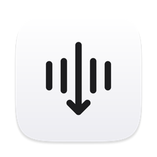
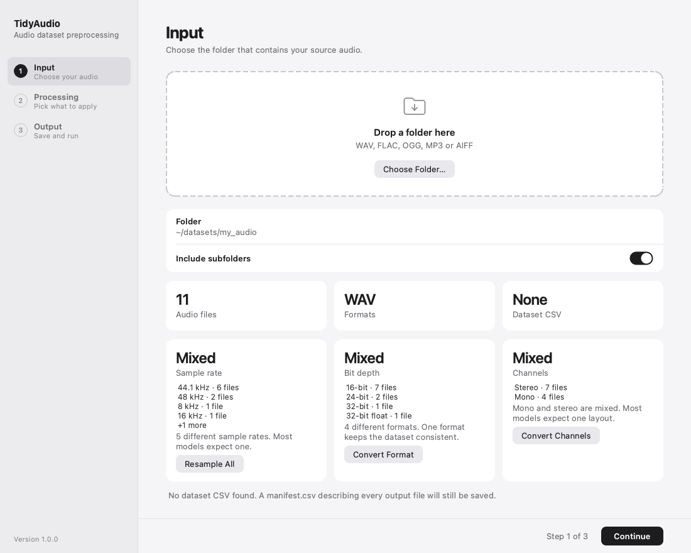
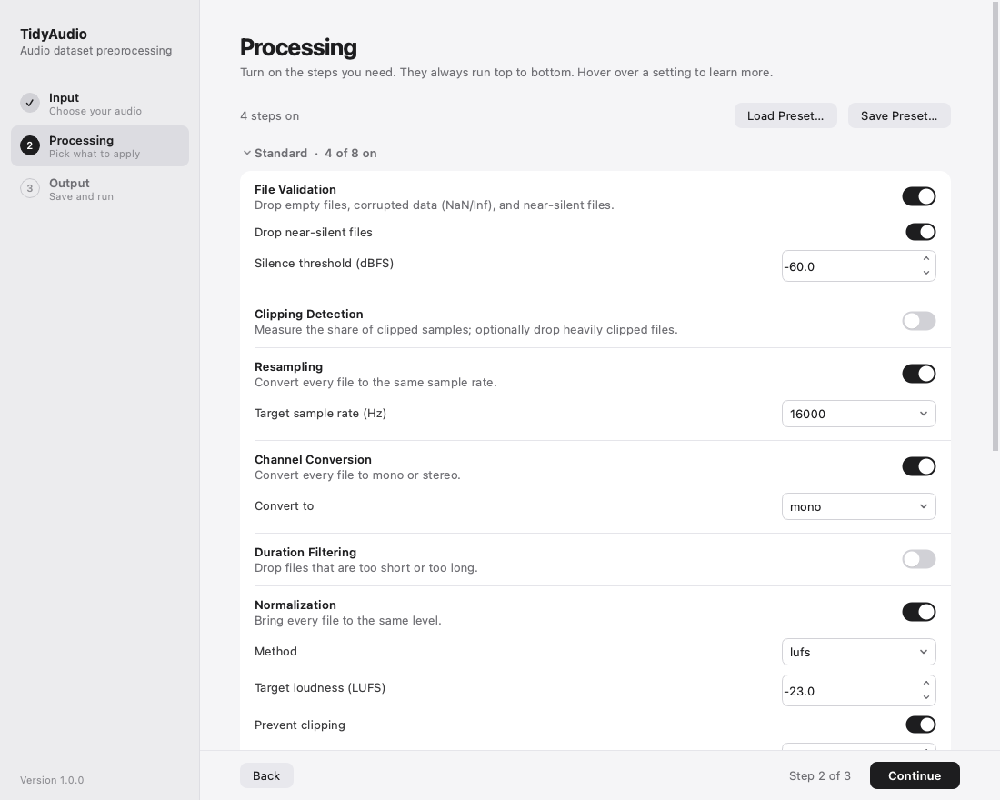
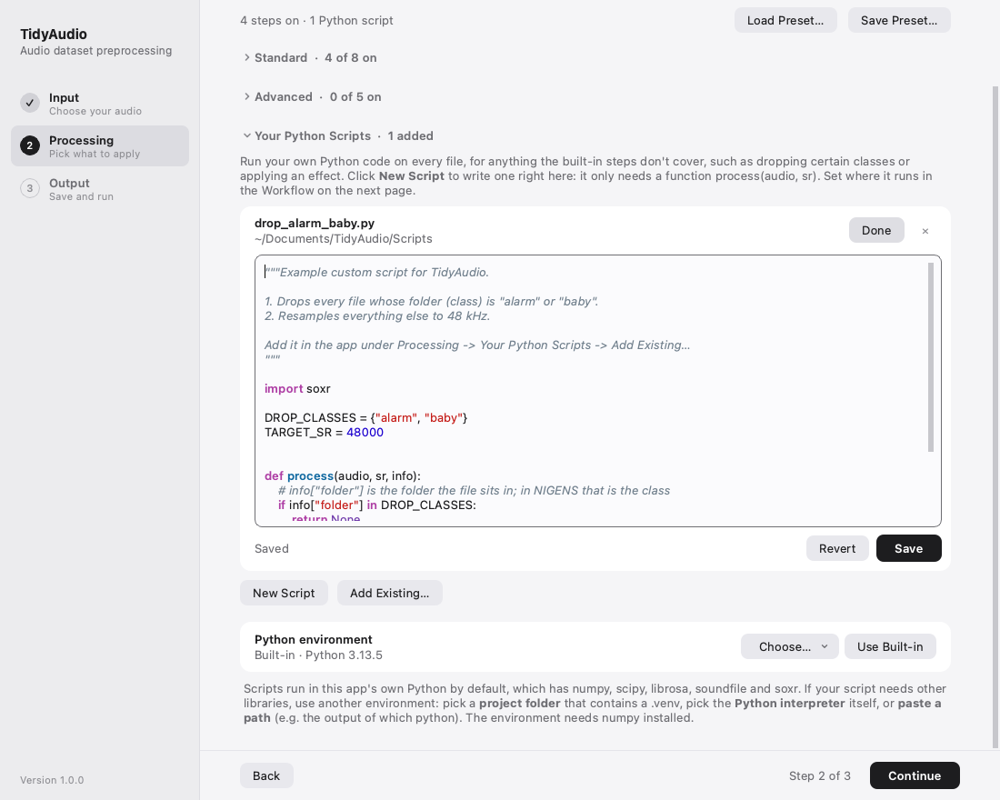
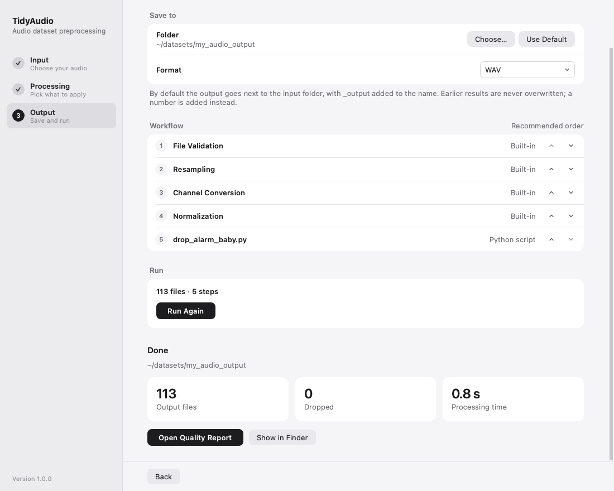

<p align="center">
  
</p>

<h1 align="center">TidyAudio</h1>

<p align="center">
  A desktop app for preparing audio datasets for machine learning and research.<br>
  Point it at a folder, pick the processing you need, and get a clean, documented dataset back.
</p>

---

Preparing an audio dataset usually means writing the same scripts again and again: resample,
convert to mono, normalize, cut into segments, check for broken or clipped files, and keep the
labels in sync. When the source data changes, you edit paths and run everything again.

TidyAudio turns that into a three-step app. Every run also writes down exactly what it did, so a
dataset can be rebuilt or described in a paper later.

<p align="center">
  
  
</p>
<p align="center">
  
  
</p>

## Features

- **Three steps:** choose (or drop) a folder, turn on the processing you need, choose where to
  save and run.
- **Knows your data first.** The input page shows the number of files, formats, sample rates,
  bit depths and channel layouts. If they are mixed, it says so and offers a one-click fix.
- **Built-in processing**

  | Standard | Advanced |
  |---|---|
  | File validation (empty, corrupted, silent files) | DC offset (check or remove) |
  | Clipping detection | Silence removal |
  | Resampling | High-pass filtering |
  | Channel conversion (mono / stereo) | Denoising |
  | Duration filtering | Feature extraction (RMS, spectral, log-mel, MFCC) |
  | Normalization (peak, RMS, LUFS) | |
  | Segmentation (fixed length or at pauses) | |
  | Bit depth conversion | |

- **Your own Python, right in the app.** Write a script with one function,
  `process(audio, sr)`, in the built-in editor, or add an existing `.py` file. Scripts can run in
  the app's own Python or in any other environment (a project's `.venv`, a conda environment),
  so they can use libraries the app does not ship with.
- **A workflow you can reorder.** Steps run in a recommended order. You can move any step or
  script, and the app warns about orders that are likely a mistake (for example, detecting
  clipping after normalization).
- **Keeps your labels.** If the dataset has a CSV (such as `file_list.csv`), an updated copy is
  written: durations and sample rates are corrected, dropped files are removed, segments get one
  row each, and all other columns (like `class`) are kept.
- **A quality report** (`report.html`) with duration and loudness distributions, class balance,
  clipped files, nearly silent outputs and the reasons files were dropped.
- **Reproducible.** Every output folder contains the full settings (`config.yaml`), a record of
  each step (`processing_steps.csv`), a copy of every script used, and a README describing the
  run. Load any `config.yaml` as a preset to run the same processing on new data.
- **Never overwrites.** Output goes next to the input folder as `<name>_output`, and a number is
  added if that already exists.

## Download (macOS)

Download the zip for your Mac from the [Releases](../../releases) page:

| Your Mac | File | Needs |
|---|---|---|
| Apple silicon (M1 or newer) | `TidyAudio-<version>-macOS-arm64.zip` | macOS 12.3 or newer |
| Intel | `TidyAudio-<version>-macOS-x86_64.zip` | macOS 12 or newer |

Unzip it and drag **TidyAudio** to Applications. The app is not signed with an Apple developer
certificate, so macOS blocks it the first time:

- **macOS 15 or newer:** open it once, click *Done*, then go to **System Settings → Privacy &
  Security** and click **Open Anyway**.
- **macOS 12–14:** right-click the app, choose **Open**, then click **Open** again.

## Run from source

Requires Python 3.10 or newer.

```bash
git clone https://github.com/enqilian/TidyAudio.git
cd TidyAudio
python3 -m venv .venv
.venv/bin/pip install -r requirements.txt
.venv/bin/python -m tidyaudio gui
```

## Command line

Everything the app does is also available without the interface, which is useful on a server:

```bash
# Count the audio files in a folder
.venv/bin/python -m tidyaudio scan path/to/audio

# Process with saved settings (any preset or config.yaml from a previous output)
.venv/bin/python -m tidyaudio run my_preset.yaml

# Same settings, new data
.venv/bin/python -m tidyaudio run path/to/old_output/config.yaml -i path/to/new_audio

# Rebuild the quality report of an output folder
.venv/bin/python -m tidyaudio report path/to/output
```

## Writing a script

A script is a `.py` file with one function. TidyAudio calls it once per file (or per segment,
if it runs after segmentation):

```python
import soxr

def process(audio, sr, info):
    # audio: numpy array, shape (samples, channels), float32, roughly -1 to 1
    # sr:    sample rate in Hz
    # info:  {"file": "alarm/a01.wav", "folder": "alarm", "name": "a01"}  (optional argument)
    if info["folder"] in {"alarm", "baby"}:
        return None                                   # drop this file
    return soxr.resample(audio, sr, 48000), 48000     # keep it, resampled
```

| Return | Effect |
|---|---|
| `(audio, sr)` | keep the file |
| `None` | drop the file |
| `[(audio1, sr1), (audio2, sr2)]` | turn one file into several |

The `info` argument is optional; `def process(audio, sr)` works too. The returned audio may be
`(samples, channels)`, a 1-D mono array, or `(channels, samples)` as librosa uses.

By default scripts run in the app's own Python, which includes numpy, scipy, librosa, soundfile
and soxr. To use other libraries, choose another environment under *Python environment*: a
project folder that contains a `.venv`, a Python interpreter, or a pasted path. That environment
only needs numpy.

See [`examples/`](examples) for a complete script.

## Output

```
my_dataset_output/
├── dataset/                  the processed dataset, same folder layout as the input
│   ├── dog/ ...
│   ├── file_list.csv         updated copy of the dataset CSV (if the input had one)
│   ├── summary.csv           files and total duration per class
│   └── README.txt            how this dataset was made
├── features/                 one .npz per file (if feature extraction is on)
├── scripts/                  copies of the scripts that were used
├── manifest.csv              one row per output file, with every measurement
├── dropped.csv               files that were dropped, and why
├── processing_steps.csv      each step, its settings, and how many files it kept or dropped
├── report.html               quality report
└── config.yaml               all settings; load it as a preset to run again
```

## Development

```bash
.venv/bin/python -m pytest tests                # run the tests
```

Build the macOS apps (on an Apple silicon Mac; the Intel build runs through Rosetta and needs
Anaconda or Miniconda to create an Intel Python):

```bash
bash packaging/setup_build_env.sh arm           # once
bash packaging/setup_build_env.sh intel         # once
bash packaging/build_mac.sh arm                 # → dist/TidyAudio-<version>-macOS-arm64.zip
bash packaging/build_mac.sh intel               # → dist/TidyAudio-<version>-macOS-x86_64.zip
```

The build environments pin library versions that still support macOS 12
(`packaging/constraints-build.txt`), so the apps run on older Macs.

### Project layout

```
tidyaudio/
├── steps/            built-in processing steps (one small class each)
├── pipeline.py       runs the steps in order and writes the output folder
├── custom_script.py  loads user scripts, in this Python or another environment
├── script_runner.py  runs a user script inside another Python environment
├── dataset_csv.py    reads and updates the dataset's own CSV
├── report.py         builds report.html
├── scan.py           finds audio files and reads their formats
└── gui/              the desktop app (PySide6)
tests/                pytest suite
packaging/            macOS app build scripts and icon
examples/             example scripts
```

Adding a built-in step means writing one class in `tidyaudio/steps/` with its parameters and an
`apply()` method; the app builds its settings interface automatically.

## License

TidyAudio is free for **noncommercial use** under the
[PolyForm Noncommercial License 1.0.0](LICENSE.md): personal use, study, research, teaching, and
use by schools, universities, public research and nonprofit organizations.

**Commercial use is not permitted** under this license. If you would like to use TidyAudio
commercially, please open an issue to ask about a separate license.

TidyAudio builds on open-source libraries that keep their own licenses, including PySide6 / Qt
(LGPL), libsndfile and soxr (LGPL), numpy, scipy, librosa, soundfile and matplotlib. The macOS
app includes their license texts in `TidyAudio.app/Contents/Resources/THIRD_PARTY_LICENSES.txt`.
